<div align="center">


# OpsCenter

**Aplicación web segura con monitoreo en tiempo real y copiloto de IA para diagnosticar la infraestructura.**

Microproyecto 2 · Servicios Telemáticos


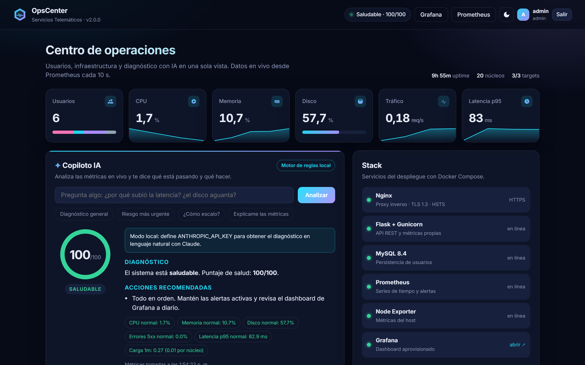

</div>

---

## Contenido

- [Qué es](#qué-es)
- [Capturas](#capturas)
- [Arquitectura](#arquitectura)
- [Inicio rápido](#inicio-rápido)
- [Copiloto IA](#copiloto-ia)
- [API](#api)
- [Observabilidad](#observabilidad)
- [Seguridad](#seguridad)
- [Pruebas](#pruebas)
- [Estructura del proyecto](#estructura-del-proyecto)
- [Despliegue en VM con Vagrant](#despliegue-en-vm-con-vagrant)
- [Solución de problemas](#solución-de-problemas)

## Qué es

OpsCenter empezó como un CRUD de usuarios en Flask y ahora es un **centro de operaciones** completo, empaquetado con Docker Compose:

- **Acceso con inicio de sesión** y permisos por rol: solo los administradores modifican usuarios; el resto ve en modo lectura.
- **Gestión de usuarios** con contraseñas con hash, validación por campo, roles, búsqueda y filtros.
- **Sin contraseñas por defecto**: el primer arranque genera claves aleatorias para la app, MySQL y Grafana.
- **HTTPS de verdad**: Nginx como proxy inverso con TLS 1.2/1.3, HTTP/2, HSTS, CSP y rate limiting. El certificado se genera solo en el primer arranque.
- **Monitoreo**: Prometheus recolecta métricas del host (Node Exporter) y de la propia aplicación (tráfico, latencia, errores, usuarios). Grafana trae un dashboard aprovisionado como código y hay 6 reglas de alerta.
- **Copiloto IA**: lee las métricas en vivo, calcula un puntaje de salud y, con Claude, explica en lenguaje natural qué pasa y qué hacer. Sin API key sigue funcionando con un motor de reglas local.

## Capturas

| Inicio de sesión |
|---|
| 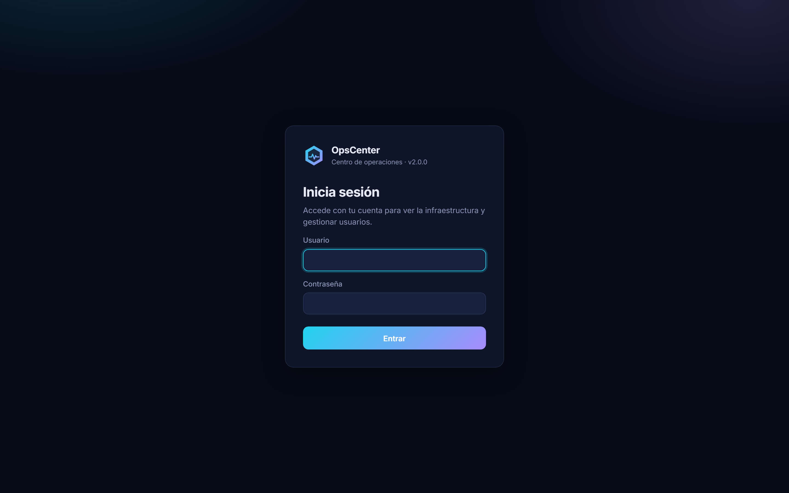 |

| Dashboard completo | Copiloto IA |
|---|---|
| 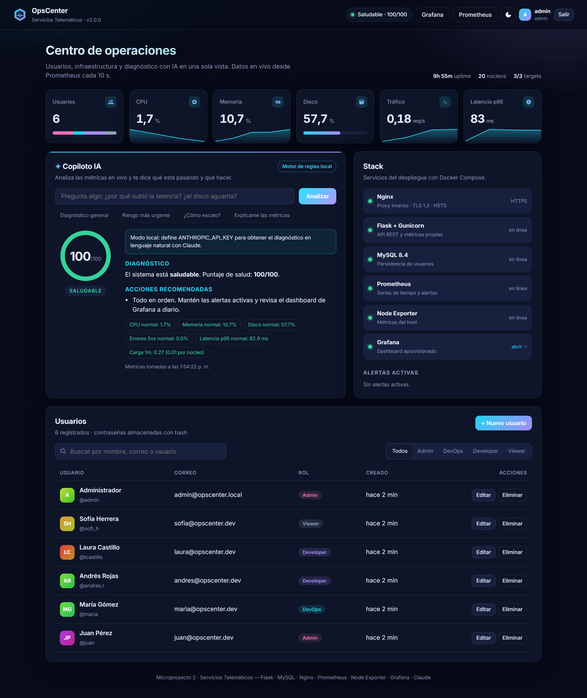 | 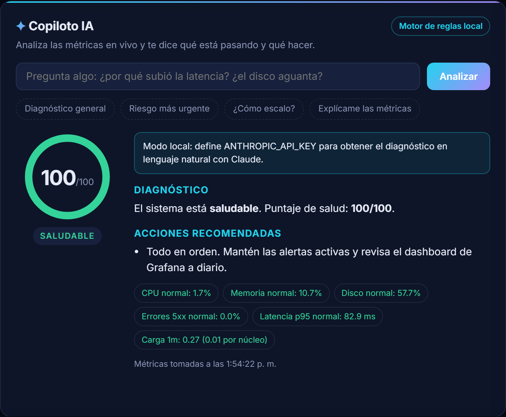 |

| Validación por campo | Tema claro + filtro por rol |
|---|---|
| 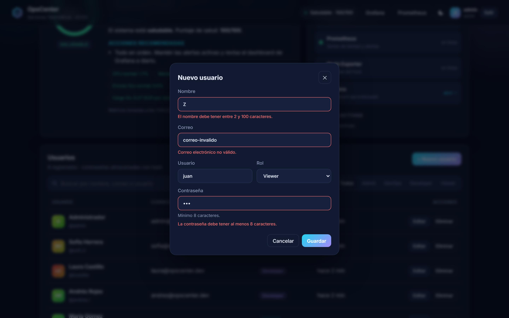 | 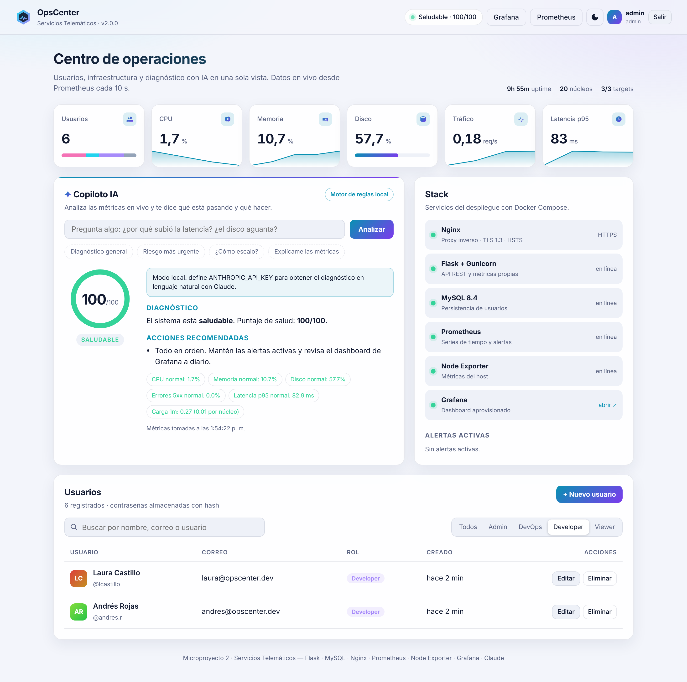 |

| Grafana: dashboard aprovisionado |
|---|
| 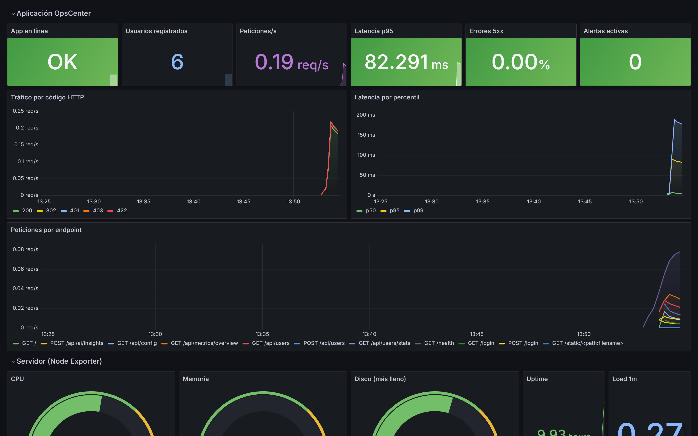 |

| Prometheus: targets | Prometheus: reglas de alerta |
|---|---|
| 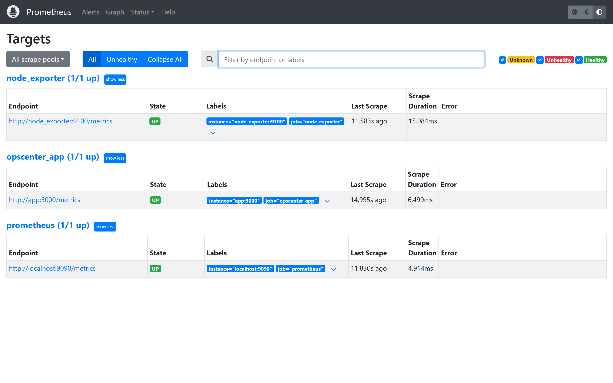 | 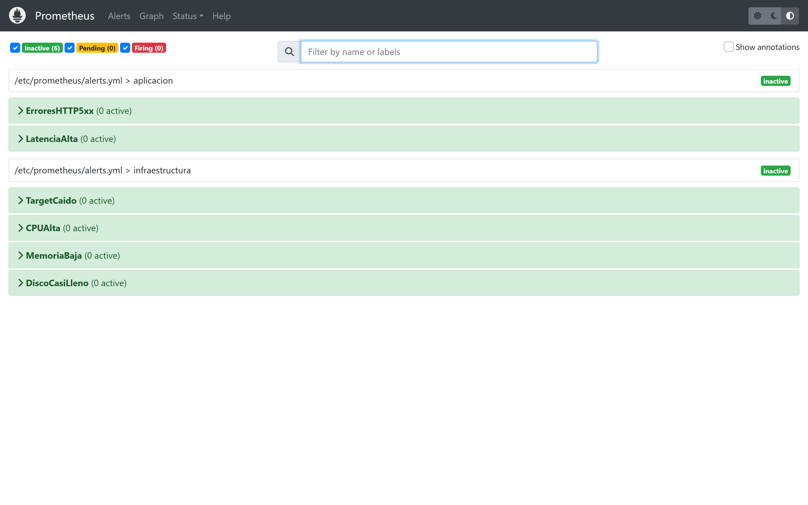 |

<details>
<summary>Vista móvil</summary>
<br>
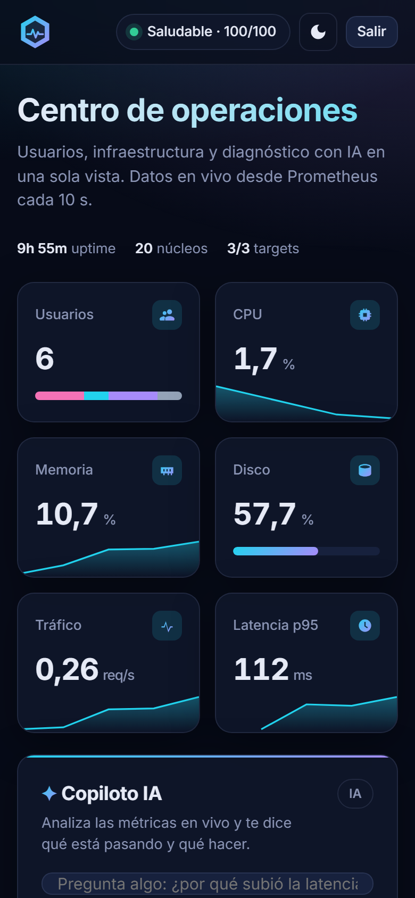
</details>

## Arquitectura

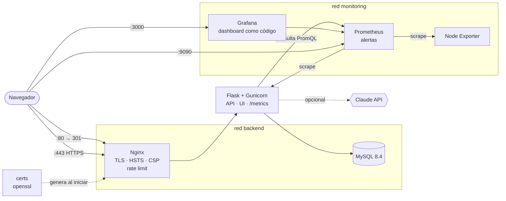

| Servicio | Imagen | Rol |
|---|---|---|
| `certs` | `alpine:3.20` | Genera el certificado autofirmado con SAN si no existe y termina |
| `db` | `mysql:8.4` | Base de datos, con healthcheck y volumen persistente |
| `app` | build `./webapp` | Flask 3 + Gunicorn, usuario sin privilegios, healthcheck en `/health` |
| `nginx` | `nginx:1.27-alpine` | Proxy inverso HTTPS, redirección HTTP→HTTPS |
| `node_exporter` | `prom/node-exporter:v1.8.2` | Métricas del host |
| `prometheus` | `prom/prometheus:v2.54.1` | Series de tiempo, reglas de alerta, 7 días de retención |
| `grafana` | `grafana/grafana:11.2.2` | Datasource y dashboard aprovisionados |

## Inicio rápido

Requisitos: Docker con Docker Compose v2.

```bash
git clone https://github.com/zemogc/microproyecto2-servicios-telematicos.git
cd microproyecto2-servicios-telematicos
docker compose up -d --build
cat secrets/admin_password    # contraseña del usuario "admin" de OpsCenter
```

No hace falta configurar nada: en el primer arranque se generan contraseñas aleatorias en `secrets/` (ignorada por git). Si quieres personalizar algo (por ejemplo, agregar `ANTHROPIC_API_KEY`), copia `.env.example` a `.env`.

En menos de un minuto todo queda arriba (`docker compose ps` muestra los servicios `healthy`):

| Servicio | URL | Credenciales |
|---|---|---|
| OpsCenter | https://localhost | `admin` / contenido de `secrets/admin_password` |
| Grafana | http://localhost:3000 | `admin` / contenido de `secrets/grafana_admin_password` |
| Prometheus | http://localhost:9090 | Solo accesible desde tu máquina |

> El certificado es autofirmado, así que el navegador mostrará una advertencia la primera vez. Para desplegar en otra IP, agrégala a `CERT_HOSTS` y borra `nginx/certs/` para regenerarlo.

Se crean además 5 usuarios de ejemplo **sin contraseña utilizable**: el administrador puede asignarles una desde la interfaz para probar los roles. Desactívalo con `SEED_DEMO_DATA=false`.

## Copiloto IA

El panel **Copiloto IA** responde a "¿cómo está mi sistema y qué hago?" con datos reales:

1. **Instantánea**: la app consulta a Prometheus CPU, memoria, disco, carga por núcleo, tráfico, % de errores 5xx, latencia p95, targets caídos y alertas activas.
2. **Motor de reglas** ([`insights.py`](webapp/app/services/insights.py)): calcula un **puntaje de salud de 0 a 100**, clasifica los hallazgos (ok / advertencia / crítico) y propone acciones concretas. Funciona siempre, sin internet.
3. **Claude** ([`copilot.py`](webapp/app/services/copilot.py)): si defines `ANTHROPIC_API_KEY`, la instantánea y la evaluación se envían a Claude, que devuelve un diagnóstico en español con *Diagnóstico*, *Riesgos* y *Acciones recomendadas*, incluyendo comandos de `docker compose` o consultas PromQL. También acepta preguntas libres, por ejemplo "¿cómo escalo esta app si el tráfico se duplica?".
4. **Tolerancia a fallos**: si no hay clave, la clave es inválida, se alcanza el límite de uso o el modelo declina, se responde con el análisis local y un aviso. La app nunca falla por culpa de la IA.

```bash
# .env
ANTHROPIC_API_KEY=sk-ant-...
AI_MODEL=claude-opus-5-5     # opcional
```

Nginx limita `/api/ai/` a 6 peticiones por minuto por IP, y cada diagnóstico queda contado en la métrica `opscenter_ai_insights_total{provider,outcome}`.

> Las capturas de este README muestran el **modo local** (motor de reglas), porque se generaron sin API key.

## API

Toda la API exige sesión iniciada (cookie `HttpOnly`, `Secure`, `SameSite`); sin ella responde `401`. Crear, editar y eliminar usuarios requiere rol `admin` (`403` en otro caso).

| Método | Ruta | Descripción |
|---|---|---|
| `POST` | `/login` · `/logout` | Inicia o cierra sesión (formulario) |
| `GET` | `/api/auth/me` | Usuario de la sesión actual |
| `GET` | `/api/users?q=&role=&page=&per_page=` | Lista paginada con búsqueda y filtro por rol |
| `GET` | `/api/users/stats` | Total y conteo por rol |
| `GET` | `/api/users/<id>` | Detalle de un usuario |
| `POST` | `/api/users` | Crea un usuario (`name`, `email`, `username`, `password`, `role`) |
| `PUT` | `/api/users/<id>` | Actualiza; si `password` se omite, se conserva la actual |
| `DELETE` | `/api/users/<id>` | Elimina |
| `GET` | `/api/metrics/overview?minutes=30` | Instantánea, series y puntaje de salud |
| `POST` | `/api/ai/insights` | `{ "question": "..." }` → diagnóstico (`provider`: `claude` o `local`) |
| `GET` | `/health` | Estado de la app y de MySQL (`200` / `503`) |
| `GET` | `/metrics` | Métricas para Prometheus (solo dentro de la red de monitoreo) |

Los errores siempre llegan en JSON. Las validaciones devuelven `422` con el detalle por campo y los duplicados `409`:

```json
{
  "error": "Datos inválidos.",
  "fields": { "email": "Correo electrónico no válido.", "password": "La contraseña debe tener al menos 8 caracteres." }
}
```

## Observabilidad

**Métricas propias de la aplicación** ([`metrics.py`](webapp/app/metrics.py)):

| Métrica | Tipo | Descripción |
|---|---|---|
| `opscenter_http_requests_total{method,endpoint,status}` | Counter | Peticiones atendidas |
| `opscenter_http_request_duration_seconds` | Histogram | Latencia (p50/p95/p99 en Grafana) |
| `opscenter_users_total` | Gauge | Usuarios registrados |
| `opscenter_ai_insights_total{provider,outcome}` | Counter | Diagnósticos del copiloto |
| `opscenter_build_info` | Info | Versión desplegada |

**Reglas de alerta** ([`prometheus/alerts.yml`](prometheus/alerts.yml)):

| Alerta | Condición | Severidad |
|---|---|---|
| `TargetCaido` | `up == 0` durante 1 min | critical |
| `CPUAlta` | CPU > 85 % durante 5 min | warning |
| `MemoriaBaja` | Memoria usada > 90 % durante 5 min | warning |
| `DiscoCasiLleno` | Disco > 85 % durante 10 min | warning |
| `ErroresHTTP5xx` | > 5 % de respuestas 5xx durante 5 min | critical |
| `LatenciaAlta` | p95 > 1 s durante 5 min | warning |

**Grafana**: el dashboard *OpsCenter · Aplicación e Infraestructura* ([`grafana/dashboards/opscenter.json`](grafana/dashboards/opscenter.json)) se aprovisiona automáticamente y queda como página de inicio. Tiene 20 paneles: estado de la app, usuarios, tráfico por código HTTP, percentiles de latencia, peticiones por endpoint, CPU, memoria, disco, red, uptime y carga. El dashboard comunitario *Node Exporter Full* (ID `1860`) también se puede importar desde la interfaz.

La explicación de las métricas del sistema está en [METRICAS.md](METRICAS.md).

## Seguridad

- **Autenticación obligatoria** para el dashboard y toda la API. Cookie de sesión `HttpOnly`, `Secure` y `SameSite=Lax`, con expiración a las 8 h; cambiar la contraseña cierra las sesiones abiertas.
- **Autorización por rol**: solo `admin` crea, edita o elimina usuarios. Un admin no puede borrarse ni quitarse el rol a sí mismo, para no dejar el sistema sin administrador.
- **Protección CSRF**: las peticiones que modifican datos desde otro origen se rechazan (`403`).
- **Freno a fuerza bruta**: `/login` admite 10 intentos por minuto por IP (luego `429`), los intentos fallidos quedan en el log y la respuesta tarda lo mismo exista o no el usuario.
- **Sin contraseñas por defecto**: MySQL, la clave de sesión, el admin de OpsCenter y el de Grafana usan secretos aleatorios generados en `secrets/` y montados como archivos (`*_FILE`), no como variables a la vista.
- **Monitoreo no expuesto**: Grafana y Prometheus solo escuchan en `127.0.0.1` y la API de administración de Prometheus (`/-/quit`, `/-/reload`) está desactivada.
- Contraseñas con hash (`werkzeug.security`, scrypt). El hash nunca sale en la API.
- TLS 1.2/1.3 con HTTP/2, HSTS, `Content-Security-Policy` estricta (sin scripts inline), `X-Frame-Options: DENY`, `nosniff`, `Referrer-Policy` y `Permissions-Policy`.
- Rate limiting en Nginx: 20 r/s para `/api/`, 6 r/min para `/api/ai/` y 10 r/min para `/login`.
- `/metrics` bloqueado desde fuera: solo Prometheus lo lee por la red interna.
- Redes Docker separadas (`backend` / `monitoring`). MySQL no expone puertos.
- La app corre como usuario sin privilegios (`uid 10001`).
- `secrets/`, `.env`, el certificado y la llave se generan localmente y nunca se versionan.

## Pruebas

34 pruebas con `pytest` (SQLite en memoria; Prometheus y Claude simulados):

```bash
cd webapp
pip install -r requirements-dev.txt
pytest -q
```

O sin instalar nada en tu máquina:

```bash
docker run --rm -v "$PWD/webapp:/src" -w /src python:3.12-slim \
  sh -c "pip install -q -r requirements-dev.txt && pytest -q"
```

## Estructura del proyecto

```
.
├── docker-compose.yml          # 7 servicios, healthchecks, redes y volúmenes
├── .env.example                # variables de configuración
├── Vagrantfile                 # VM Ubuntu con Docker en 192.168.50.3
├── scripts/generate-secrets.sh # contraseñas aleatorias en el primer arranque
├── nginx/
│   ├── default.conf            # TLS, cabeceras de seguridad, rate limit
│   └── generate-certs.sh       # certificado autofirmado con SAN
├── prometheus/
│   ├── prometheus.yml          # jobs: prometheus, node_exporter, opscenter_app
│   └── alerts.yml              # 6 reglas de alerta
├── grafana/
│   ├── provisioning/           # datasource + proveedor de dashboards
│   └── dashboards/opscenter.json
├── docs/screenshots/
└── webapp/
    ├── Dockerfile · gunicorn.conf.py · wsgi.py
    ├── app/
    │   ├── __init__.py         # app factory, bootstrap de BD y datos demo
    │   ├── auth.py             # sesión, roles, CSRF y cuenta admin inicial
    │   ├── config.py · models.py · metrics.py
    │   ├── api/                # users, insights, system
    │   ├── services/           # prometheus, insights (reglas), copilot (Claude)
    │   ├── templates/          # index.html, login.html
    │   └── static/             # css, js, logo
    └── tests/
```

## Despliegue en VM con Vagrant

```bash
vagrant up
```

Crea una VM Ubuntu 22.04 en `192.168.50.3`, instala Docker y ejecuta `docker compose up -d --build`. Al terminar muestra la contraseña de `admin`. Luego abre https://192.168.50.3, http://192.168.50.3:3000 y http://192.168.50.3:9090 (en la VM el monitoreo escucha en la red privada host-only).

## Solución de problemas

| Síntoma | Solución |
|---|---|
| El navegador advierte del certificado | Es autofirmado: acepta la excepción o importa `nginx/certs/server.crt` |
| Cambié de IP y el certificado no coincide | Agrega la IP a `CERT_HOSTS`, borra `nginx/certs/` y ejecuta `docker compose up -d` |
| El copiloto dice "Modo local" | Define `ANTHROPIC_API_KEY` en `.env` y ejecuta `docker compose up -d app` |
| Disco aparece como "sin datos" | Node Exporter no ve sistemas de archivos ext4/xfs/btrfs/zfs escribibles en el host |
| `429 Too Many Requests` en el copiloto | Es el rate limit de Nginx: espera un minuto |
| ¿Cuál es la contraseña? | `cat secrets/admin_password` (OpsCenter) y `cat secrets/grafana_admin_password` (Grafana) |
| Olvidé o quiero cambiar la contraseña de admin | Cámbiala desde la tabla de usuarios, o borra la BD con `docker compose down -v` y `secrets/admin_password` para regenerarla |
| Vengo de una versión anterior y la app no conecta a MySQL | La BD se creó con la contraseña antigua: pon ese valor en `MYSQL_PASSWORD` de `.env` y borra `secrets/db_password`, o reinicia con `docker compose down -v` |
| `429` al iniciar sesión | Demasiados intentos: espera un minuto |
| Reiniciar desde cero | `docker compose down -v` (borra la BD y el historial de métricas) |

## Licencia

Distribuido bajo la licencia MIT. Consulta [LICENSE](LICENSE).
